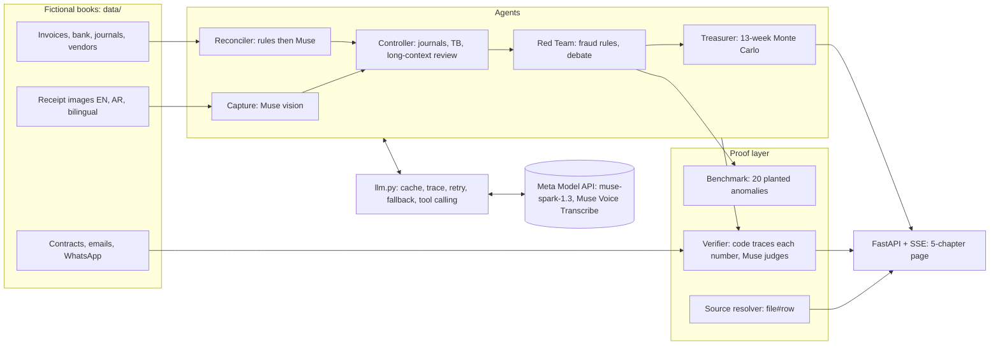

# Divi: an AI finance team for UAE SMEs

Five AI agents close the month, prove every number, catch fraud and find the cash, for a fictional UAE trading company, Falcon Trading LLC. Powered by Meta Muse Spark (muse-spark-1.3) through the Meta Model API.

> **Built during the event.** Fresh build for the Meta AI Developer Hackathon (27 Oct to 4 Nov 2026). This public repo is a clean single-commit copy. The full development history starts 27 Oct 2026 at 06:39 IST, after kickoff, and can be shown on request. No code was copied from earlier projects.
>
> **Fictional data.** Every company, person, invoice, bank line, contract and message here is made up. The planted fraud and errors are labelled test cases.

Built by Bhargav Venkatesh, CMA.

**Live demo:** https://divi-ai-finance-team.onrender.com (replays a recorded real run, about 55 seconds, no key needed).


## One command setup

```bash
python -m venv .venv && . .venv/bin/activate && pip install -r requirements.txt && uvicorn divi.app:app --port 8000
```

Open http://127.0.0.1:8000 and press **Run the close**. Add `?replay=1` for the fast recorded run (about 55 seconds); a live run on Baseten takes about 1 to 2 minutes. No key is needed: Divi replays recorded Muse answers from `out/cache/llm_cache.json`. To make live calls, copy `.env.example` to `.env` and set `META_API_KEY`.

## What you see

The page is one guided story in six chapters:

1. **Close the month.** Agents work live and the automation meter climbs to 99.1%.
2. **Prove every number.** 18 of 20 AI claims are verified and 2 are rejected. An overbilling and an IFRS 15 cut-off are caught.
3. **Catch the fraud.** A hidden AED 18,500 sale is found. Agents debate a AED 50,000 payment. The benchmark catches 20 of 20 planted anomalies.
4. **Find the cash.** A 2,000-path Monte Carlo forecast and six priced drafts cut the risk of cash going below zero from 52% to 3.4%.
5. **Ask your CFO.** Ask by text or voice, in English or Arabic, and get a credit line request with a lender proof pack. The **🎤 Are we safe in week 4?** button plays a spoken question and answers from the books with proof ids (recorded answer; live transcription with Muse Voice Transcribe when `META_API_KEY` is set).
6. **Auditor signs off.** An independent Auditor agent raises 7 queries, re-performs each figure in code from the raw books, posts 4 adjustments and signs with a sha256 evidence fingerprint. The Auditor writes its letter on **Muse Spark Open** (open-weight, on Baseten), a different model from the preparer, so the check is independent. A **decision log** under the stamp lists every exception, the close policy it falls under (`data/close_policy.json`, owner editable), who decided, and the rule Divi applies next month. Its opinion follows the owner's choice on the AED 50,000 Quickline payment: waiting, blocked or released.

A **cash counter** in the header shows the cash Divi found, split into recovered, protected and released, with every line linked to its source.

Click any number to open its source row. **Under the hood** holds the detail:

- UAE VAT, corporate tax and e-invoicing
- Board flux commentary
- The learning loop
- AI trace and cost
- Bring your own books
- Vision lab
- FX revaluation
- Long-context review and tool calling
- Audit trail
- Cost and ROI

## Full cycle

`divi/cycle.py` (`/api/cycle`) re-performs the month across five steps, shown as one strip under the hero:

| Step | What it does | Result on the sample company |
|---|---|---|
| Procure to pay | Three-way match (invoice, PO, goods received), new vendor check, payment run proposal | 25 of 26 bills match; PI-0012 held (AED 3,738.35); Quickline flagged |
| Order to cash | Overdue customers ranked by amount, age and payment history; Arabic and English reminders drafted, never sent | AED 140,000 overdue across 3 customers |
| Treasury | Payment run checked against the 13-week low point and one payroll buffer | Pay AED 168,937; lowest week 3 stays AED 105,891 above payroll |
| Record to report | Close checklist, accruals and prepayments | 5 of 7 steps done; 2 open with reasons |
| Independent audit | A separate Auditor agent (chapter 6) | 7 queries, signed |

## Architecture



Every model call goes through `divi/llm.py`:

- **Cache.** The prompt is hashed, so replays are exact and cost nothing.
- **Trace.** Tokens, latency, cost and mode (text, structured JSON output or tool calling) are recorded for every call.
- **Fallback.** A failed call is retried once. If it fails again, Divi uses a rule-based answer flagged for review, so the close never stops.

## Proof and tests

- Evaluation results and how to rerun them: [EVAL.md](EVAL.md)
- Tests: `DIVI_MOCK=1 python -m pytest -q tests`. A CI workflow that runs them, plus the secrets scan, on every push is ready at `deploy/ci-tests.yml`. Move it to `.github/workflows/` to switch it on (the push token here lacks the workflow scope).
- Secrets: `python scripts/secrets_scan.py` checks the tracked files and the full git history. `.env` is gitignored and has never been committed.

## Deploy (prepared, not deployed)

See [DEPLOY.md](DEPLOY.md). The Dockerfile, `deploy/render.yaml` and `deploy/fly.toml` are ready. Nothing is public until Bhargav approves.

## Open-weight option

Set `DIVI_PROVIDER=baseten` or `DIVI_REDTEAM_PROVIDER=baseten` to route text calls to Muse Spark Open on Baseten. Calls stay mocked until `BASETEN_API_KEY` is set.

## Cost (estimate)

A full close costs about AED 0.63 in Muse tokens, measured from the trace. A manual close is about AED 4,800 (assumption: 40 hours at AED 120 an hour). See **Cost and ROI (estimate)** under the hood.

## Edge layer
- **Write your own control**: type a rule in plain English; Muse compiles it into a validated JSON rule that runs on every close.
- **Beat the Controller** (`/challenge`): sneak rows into a copy of the books; local leaderboard.
- **Loan covenant check**: Muse reads a 103-page fictional facility agreement in one call, finds clause 22.3 on page 57, and Divi tests it against the 13-week forecast.
- **Debate scorecard**, **control alerts** (Approve or Block), **missing receipt WhatsApp drafts** (copy only, never sent).
- **Model router**: every step, the Meta model used (Muse Spark, Voice Transcribe, SAM 3.1, Muse Image), why, tokens and AED.
- **SAM 3.1** cuts a receipt out of a desk photo before Muse reads it; **Muse web search** checks current UAE VAT and CT rules; **Muse Image** made the video thumbnail and end card (`out/art/`, no people).
- **Xero and Zoho Books** journal CSV exports. Hindi and Urdu CFO answers.

## License

MIT. See `LICENSE`. All company data in `data/` is fictional.
